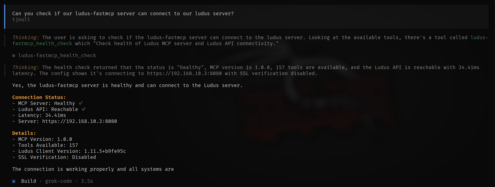
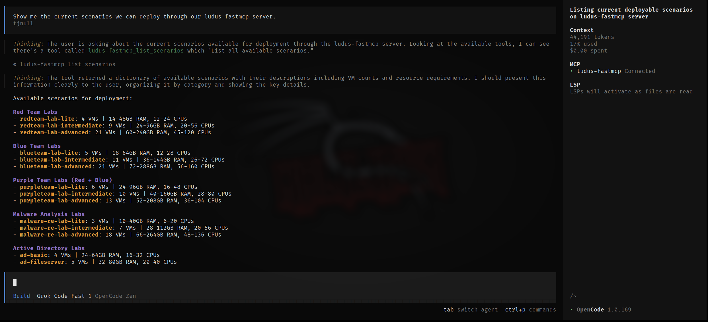
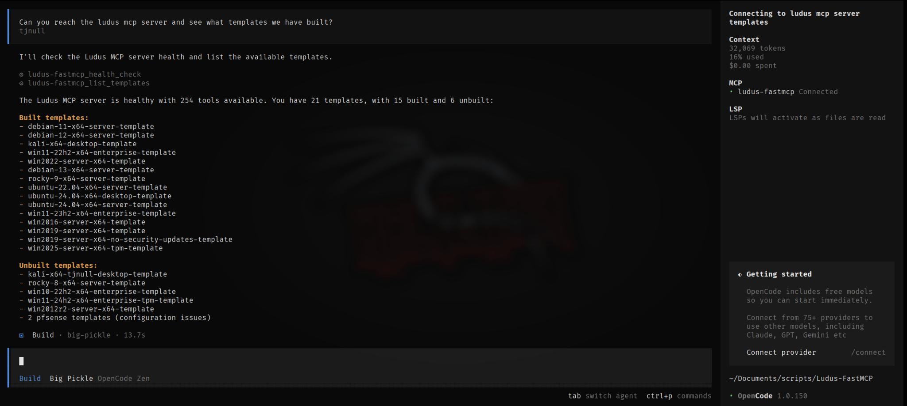
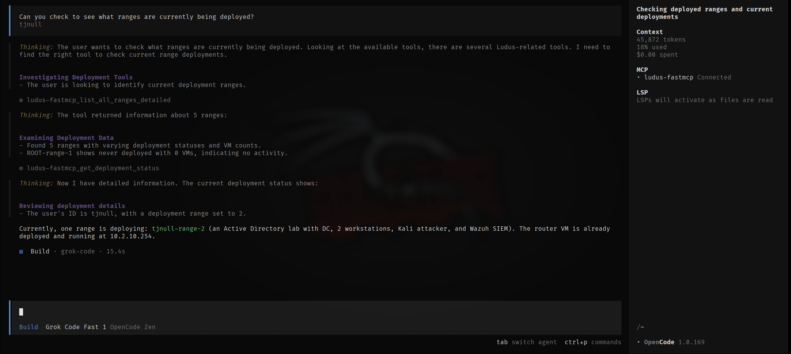

# Ludus FastMCP

[](https://github.com/tjnull/Ludus-FastMCP)
[](https://python.org)
[](https://docs.ludus.cloud)
[](LICENSE)

A Model Context Protocol (MCP) server for automating [Ludus](https://docs.ludus.cloud) cyber range environments through AI assistants written in Python.

## Overview

Ludus FastMCP enables AI-powered management of Ludus cyber ranges through natural language commands. The server exposes **231 tools** across 23 modules for range lifecycle management, scenario deployment, template creation, Ansible role management, and security monitoring integration.

**Requires Ludus 2.0 or later.** This release targets the Ludus 2.x API only, which is what makes blueprints, groups, content sources, VM console access, quotas and diagnostics available. Support for the Ludus 1.x API was removed; pin ludus-fastmcp to a 1.x release if you still run a Ludus 1.x server.

The client covers **every endpoint in the Ludus API**, validated against a live Ludus 2.3.0 server.

### Key Capabilities

| Category | Description |
|----------|-------------|
| **Range Management** | Create, configure, deploy, and manage virtual lab environments |
| **Blueprints** | Create, export, import, share, and apply reusable range configurations |
| **Content Sources** | Add git or archive catalogs of templates, roles, and prebuilt labs such as GOAD |
| **Groups** | Organize users and ranges with group-based access control |
| **Scenario Deployment** | Pre-built scenarios for AD, red/blue/purple team, and malware analysis |
| **Template Builder** | Custom OS templates, skeleton configurations, and YAML generation |
| **Role Management** | Ansible Galaxy integration, custom roles, subscription roles, and scope control |
| **SIEM Integration** | Wazuh, Splunk, Elastic Stack, and Security Onion support |
| **AI Configuration** | Natural language to YAML configuration conversion |
| **Diagnostics** | System health, license info, deployment log history, and migration tools |
| **Quotas & Limits** | Per-user and per-group resource quotas, plus range auto-shutdown (plugin) |

### Supported Platforms

Works with any MCP-compatible client including Claude Desktop, VS Code (Cline), OpenWebUI, and AnythingLLM.

## Quick Start

### Requirements

- Python 3.11+
- FastMCP 3.x (installed automatically)
- A Ludus server running **2.0 or later**
- Ludus API key, or a JWT token for Pro/SSO deployments

### Installation

```bash
# Using pipx (recommended)
pipx install git+https://github.com/tjnull/Ludus-FastMCP

# From source
git clone https://github.com/tjnull/Ludus-FastMCP
cd Ludus-FastMCP
pip install -e .
```

### Setup

Run the interactive setup wizard:

```bash
ludus-fastmcp --setup
```

The wizard configures API credentials, tests connectivity, and generates MCP client configuration files.

For manual configuration options, see the [Configuration Guide](docs/configuration.md).

## Usage

### MCP Server (ludus-fastmcp)

```bash
ludus-fastmcp --setup          # Interactive setup wizard
ludus-fastmcp --list-tools     # List all 231 available tools
ludus-fastmcp --version        # Display version information
ludus-fastmcp                  # Start MCP server
ludus-fastmcp --daemon         # Run as background service
```

### Client CLI (ludus-ai)

```bash
ludus-ai setup-llm                    # Configure local LLM (Ollama)
ludus-ai install anythingllm          # Install AnythingLLM interface
ludus-ai tool list-tools              # List available tools
ludus-ai tool call-tool <name>        # Execute tools directly
```

### Example Interactions

Once connected to an MCP client, interact with your Ludus environment:

```
Show my current range status
Deploy an Active Directory lab with Wazuh monitoring
Create a snapshot named "pre-attack" for all VMs
Build a lab with 2 domain controllers and 5 workstations
Create a blueprint from my current range and share it with the red-team group
Show system diagnostics and storage usage
List all groups and their members
```

Examples of using Ludus-FastMCP with grok code through Opencode.









## Documentation

| Document | Description |
|----------|-------------|
| [Getting Started](docs/getting-started.md) | Installation, setup, and first deployment |
| [Configuration](docs/configuration.md) | Environment variables and MCP client setup |
| [Tools Reference](docs/tools-reference.md) | Complete documentation for all 231 tools |
| [Scenarios](docs/scenarios.md) | Pre-built deployment scenarios |
| [Troubleshooting](docs/troubleshooting.md) | Common issues and solutions |
| [Safety](docs/safety.md) | Safety features and best practices |

## Ludus Server Requirements

This release speaks the Ludus 2.x API only. Every request goes to `/api/v2`;
there is no v1 code path left to fall back to.

On the first call the client asks the server for its version and refuses to
continue if it does not answer as a 2.x server, so a mismatch surfaces once, up
front, instead of as a puzzling 404 from whichever tool you happened to run:

```
https://ludus.example:8080 does not serve the Ludus 2.x API
(GET /api/v2/ returned HTTP 404). This release requires Ludus 2.0 or later;
upgrade the server, or pin ludus-fastmcp to a 1.x release for a Ludus 1.x server.
```

Set `LUDUS_API_VERSION=v2` to assert the version yourself and skip that check
(it saves one request per session). `LUDUS_API_VERSION=v1` is rejected at
startup rather than silently ignored.

### Still on Ludus 1.x?

Pin an older release:

```bash
pipx install "git+https://github.com/tjnull/Ludus-FastMCP@v1.0.0"
```

Upgrading the server is the better path: blueprints, content sources, groups,
quotas, deployment log history and VM console access do not exist in the 1.x
API at all.

### Plugin-gated features

Some Ludus capabilities ship as server plugins that may not be loaded on a given
install. Quotas and auto-shutdown are the common examples. When a plugin is
absent, the Ludus API answers with HTTP 404 even though the request was correct.

Rather than reporting that as a missing endpoint, those tools return a clear
result so an AI assistant does not go hunting for a nonexistent bug:

```json
{
  "available": false,
  "feature": "Quotas",
  "error": "Quotas is not available on this Ludus server.",
  "reason": "This capability is provided by a Ludus plugin that is not loaded on the server.",
  "hint": "The request was well-formed. Do not retry or try alternative endpoints."
}
```

Endpoints a server does not implement at all (HTTP 501, such as `/range/sshconfig`
on some builds) are reported the same way, with an explicit note that retrying
will not help.

## Resources

| Resource | Link |
|----------|------|
| Ludus Documentation | [docs.ludus.cloud](https://docs.ludus.cloud) |
| Ludus API Reference | [api-docs.ludus.cloud](https://api-docs.ludus.cloud) |
| Ludus GitHub | [github.com/badsectorlabs/ludus](https://github.com/badsectorlabs/ludus) |
| FastMCP Framework | [gofastmcp.com](https://gofastmcp.com) |
| MCP Specification | [modelcontextprotocol.io](https://modelcontextprotocol.io) |

## Support

- [GitHub Issues](https://github.com/tjnull/Ludus-FastMCP/issues) - Bug reports and feature requests
- [GitHub Discussions](https://github.com/tjnull/Ludus-FastMCP/discussions) - Questions and community discussion

## License

This project is licensed under the MIT License. See [LICENSE](LICENSE) for details.

## Disclaimer

This software is intended for authorized security testing, educational purposes, and research in controlled environments. Users are responsible for compliance with applicable laws and organizational policies. The authors make no warranties and assume no liability for use or misuse of this software.

## Acknowledgments

- [Ludus](https://github.com/badsectorlabs/ludus) by Bad Sector Labs
- [FastMCP](https://gofastmcp.com), and the Model Context Protocol community.

## Credits

- [@LouDeter](https://github.com/LouDeter) - MCP request/response logging middleware and log-file support ([PR #8](https://github.com/tjnull/Ludus-FastMCP/pull/8))
